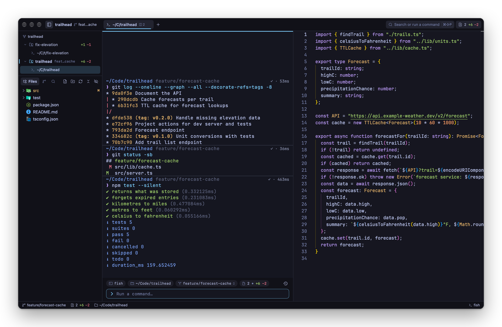
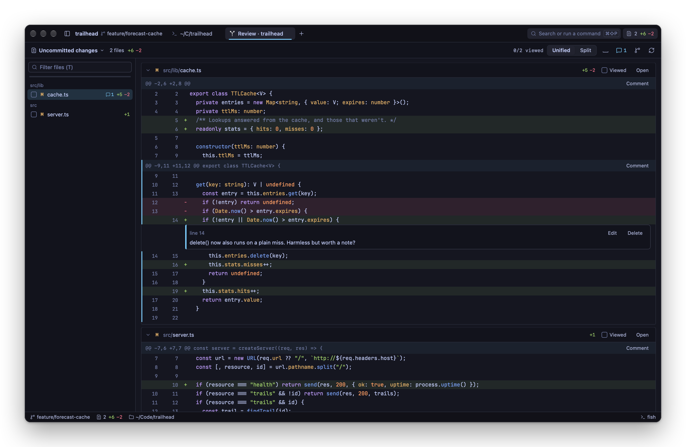
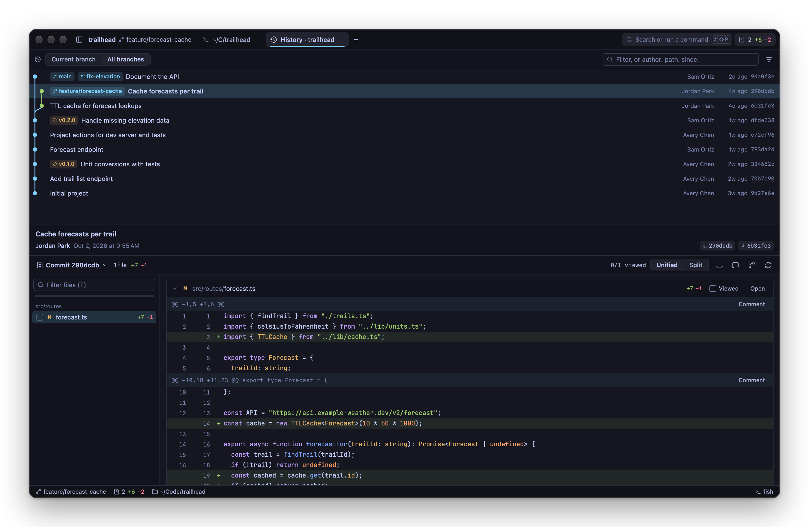

<p align="center">
  
</p>

<h1 align="center">Impulse</h1>

<p align="center">
  A terminal-first development environment for macOS and Linux.
</p>

<p align="center">
  <a href="#features">Features</a> &bull;
  <a href="docs/README.md">Documentation</a> &bull;
  <a href="#installation">Installation</a> &bull;
  <a href="#building-from-source">Building from Source</a> &bull;
  <a href="#architecture">Architecture</a> &bull;
  <a href="#license">License</a>
</p>

---

<p align="center">
  
</p>

Impulse is a terminal IDE: a fast terminal with Warp-style command blocks, a code editor with language servers, deep git integration, and first-class support for the coding agents you run in your terminals. It's built for developers who live in the terminal but want editing, review and project awareness next to it.

The app is written in Rust on [GPUI](https://www.gpui.rs/), drawn on the GPU (Metal on macOS, Vulkan on Linux), with terminal emulation built on `alacritty_terminal`. The same code builds for both platforms and works the same on each. Impulse never calls an AI service itself; it hosts the agent CLIs you already use.

**[Read the documentation](https://www.impulse-terminal.app/docs/)** for how every feature works, with screenshots (also in [`docs/`](docs/README.md)).

## Features

**Workbench**

- Workspaces in the sidebar: one per folder, each with its own tabs, with worktrees of the same repository grouped together, plus a Scratch workspace for terminals that don't belong to a project
- Tabs in the titlebar (or listed in the sidebar) and split panes of any surface; a file tree with git status
- Session restore of every window's workspaces, layouts and terminal output
- Fuzzy command palette with modes: files, `>` commands, `:` line, `%` text, `@`/`#` symbols, `t:` tabs, `w:` workspaces, `b:` branches, `h:` history, `task:` branches as tasks, `a:` project actions, `set:` settings (`?` lists them all)
- Project actions and worktree setup from `.impulse/project.toml`; the `impulse` command-line tool, which also lets Impulse be your `$EDITOR`
- An optional quick terminal on a global shortcut; ⇧⌘T reopens a closed tab (or ⌘Z right after closing it)
- 19 built-in themes plus user themes; Settings and Keyboard Shortcuts as searchable tabs
- Workspace trust: language servers, formatters on save and background fetch only run in folders you trust

**Terminal**

- Shell integration for bash, zsh and fish; command blocks with status, duration, selection, bookmarks and actions
- A multi-line input editor with shell highlighting, history (⌃R), completions for subcommands, options, branches and scripts, and an underline on commands the shell can't run (optionally with fish's own completions)
- Find with match counts and regex; hints mode to open URLs, paths, SHAs and ports from the keyboard
- Persistent command history, background notifications, listening ports, the kitty keyboard protocol, OSC 8 links and iTerm2 session status

**Coding agents**

- Recognizes Claude Code, Codex, Gemini CLI, Aider, opencode, Amp, Copilot CLI, Cursor Agent, Goose, Qwen Code and Crush in its terminals, and shows when each is working or waiting for you (⇧⌘U jumps to the next one that needs you)
- Checkpoints every agent turn so you can review it, restore files from before it, or send review comments back
- A composer (⌘I), a toolbelt, and "send to agent" for code, files and command output
- Task worktrees for parallel work; hooks and resume after a restart for Claude Code, Codex and opencode

**Git**

- Changes panel with a commit composer and keyboard control; commit and push in one step if you like
- Review with scopes (unstaged, staged, all uncommitted, against a branch, a commit, a range, a stash, the last agent turn, or everything since your last review), hunk and line staging, and comments you can send to the agent that wrote the code
- Live change marks, blame for the current line, and a side-by-side or inline diff view in the editor
- History (⇧⌘H) with a commit graph across branches, compare, author/path/date filters and fork-point dimming
- Branch switching and management, undoable stashes and merge-conflict resolution, using git alone so any host works
- Fetch, pull (fast-forward, rebase or merge), push and force push with lease from the Git menu or palette, with optional background fetch
- Tags from History or at HEAD (lightweight or annotated, optionally pushed right away); merge and rebase from History

<table>
  <tr>
    <td width="50%"></td>
    <td width="50%"></td>
  </tr>
  <tr>
    <td align="center">Review, with a comment for the agent</td>
    <td align="center">History across all branches</td>
  </tr>
</table>

**Editor**

- Language servers: completions, hover, definitions, references, rename across files, code actions, inlay hints, highlights, formatting and diagnostics in a Problems panel
- Go to symbol in a file or the project, project-wide find and replace with a preview
- Markdown and SVG preview beside the editor, with Run buttons on shell code blocks; image preview tabs
- Optional Vim keybindings; bundled JetBrains Mono for editor and terminal

**Accessibility**

- Screen readers (VoiceOver, Orca) can read the controls and the terminal's text
- Reduce Motion and Increase Contrast (GNOME's high contrast and animations on Linux) are honored

## Installation

Download from [GitHub Releases](https://github.com/dowilcox/impulse/releases):

- **macOS:** `Impulse-X.Y.Z.dmg`. Open it and drag **Impulse.app** to your **Applications** folder. Requires **macOS 26 (Tahoe)** or later on an **Apple silicon** Mac.
- **Debian and Ubuntu:** `impulse_X.Y.Z_amd64.deb` (or `_arm64`): `sudo apt install ./impulse_X.Y.Z_amd64.deb`.
- **Other Linux:** `impulse-X.Y.Z-linux-x86_64.tar.gz` (or `-aarch64`): unpack it and run `bin/impulse-app`. On Arch and its derivatives, `./scripts/build.sh` also makes a package for `pacman -U` (see [Building from Source](#building-from-source)).

Linux needs a Vulkan driver (Mesa's on most systems) and runs on Wayland or X11. Impulse checks GitHub for new releases on launch; you can turn that off in Settings.

**Language servers.** Rust, Python and C/C++ use the `rust-analyzer`, `pyright` and `clangd` on your `PATH`. For TypeScript/JavaScript, PHP, HTML, CSS, JSON, Tailwind, Vue, Svelte, GraphQL, YAML, Dockerfile and Bash, run **Install Web LSP Servers** from the command palette (or **Install All** in Settings → Language Servers). That needs Node.js and npm.

## Building from Source

Requires [Rust](https://rustup.rs/) (stable). On macOS, Xcode (GPUI compiles its Metal shaders with it); `rsvg-convert` draws the app icon and `create-dmg` makes the disk image (`brew install librsvg create-dmg`). On Linux, a C toolchain, `pkg-config` and the xcb, xkbcommon and zlib headers (on Debian and Ubuntu: `build-essential pkg-config libxcb1-dev libxkbcommon-dev libxkbcommon-x11-dev zlib1g-dev`).

```bash
git clone https://github.com/dowilcox/impulse.git
cd impulse
./scripts/build.sh --dev                     # debug build: target/debug/impulse-app
./scripts/build.sh                           # release packages in dist/
./scripts/build.sh --sign --notarize --dmg   # macOS: signed, notarized .app + .dmg
```

On macOS the release build is `dist/Impulse.app` (`scripts/package-macos.sh`); signing finds your Developer ID in the keychain, or uses `IMPULSE_SIGN_IDENTITY`, and notarizing needs `IMPULSE_NOTARY_KEY`, `IMPULSE_NOTARY_KEY_ID` and `IMPULSE_NOTARY_ISSUER`. On Linux it's a tarball, plus a `.deb` where `dpkg-deb` is installed and an Arch package where `makepkg` is (`scripts/package-linux.sh`): install the latter with `sudo pacman -U dist/impulse-X.Y.Z-1-x86_64.pkg.tar.zst`.

A debug build keeps its own settings and data (`impulse-dev`), so it runs beside an installed release:

```bash
target/debug/impulse-app --cwd <folder> [--open <file>]
```

## Testing

```bash
cargo test --workspace
python3 scripts/smoke/run.py      # headless smoke checks of the debug build (Linux: under Xvfb)
```

## Architecture

A Cargo workspace:

| Crate              | Role                                                                                         |
| ------------------ | -------------------------------------------------------------------------------------------- |
| `impulse-app`      | The app on GPUI and GPUI Kit: workbench, terminal renderer, editor, Review, History, agents  |
| `impulse-kit`      | Pure logic: themes, palette, completion, layouts, agents, settings, Vim mode, project config |
| `impulse-git`      | Git layer: reads on libgit2 (vendored, no network transports), writes through the git CLI    |
| `impulse-lsp`      | LSP client: server processes, JSON-RPC framing, document sync, managed installs              |
| `impulse-protocol` | Control-socket messages shared by the app and the CLI, and the MCP server                    |
| `impulse-cli`      | The `impulse` command-line tool: open, edit, review, split, notify from an Impulse terminal  |
| `impulse-terminal` | Terminal emulation (`alacritty_terminal`), OSC parsing, command blocks, history              |

Much of the logic is checked against golden fixtures generated from an earlier implementation (`impulse-kit/tests/fixtures`, `impulse-git/tests/fixtures`).

## Releasing

```bash
./scripts/release.sh 0.37.0          # build this platform's release into dist/ (any branch)
./scripts/release.sh 0.37.0 --push   # macOS, on main: also commit, tag, push, create the release
```

The top-level `VERSION` file is the single source of truth; the script keeps every crate's version equal to it. Without `--push` it builds exactly what a release would ship and leaves the tree as it was. With `--push` it commits the bump, tags, pushes and creates the GitHub release with the disk image; publishing it starts `.github/workflows/release-linux.yml`, which attaches the Linux packages for x86_64 and arm64.

## License

[GPLv3](LICENSE)
