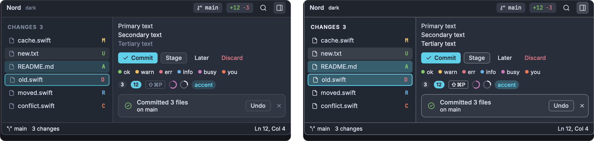

# Accessibility

Impulse works with screen readers (VoiceOver on macOS, Orca on Linux), follows your system's Reduce Motion and Increase Contrast settings, and can be driven from the keyboard. This page explains what each of these does in Impulse, the settings that make text easier to read, and where the current limits are.

## Screen readers

### Terminal output

A screen reader sees each terminal as a terminal labeled "Terminal" with the tab's title. Its text is what's on screen in that terminal, one line per row, and it follows the output as it changes. Impulse works this text out only while a screen reader is running.

Only the visible screen is exposed, not the scrollback. Scroll the terminal to read earlier output, or select command blocks and copy them (see [Terminal](terminal.md)).

### Labels

Some of Impulse's controls have labels a screen reader reads:

- **Buttons that show only an icon** are labeled with the same text as their tooltip, for example "New Tab (⌘T)".
- **Tabs** read as their title, followed by "unsaved", "needs attention" or "preview" when that applies. Each tab's close button reads "Close _title_".
- **Workspaces** in the sidebar read as the workspace's name and its branch.
- **The Files, Changes and Search buttons** at the top of the sidebar are tabs, and the file tree's rows are tree items with their name, level, and whether a folder is open.
- **The changes pill** in the titlebar reads, for example, "Review changes: 3 files, 12 added, 4 removed lines".
- The command palette's field is labeled "Palette query".

The editor, the input bar, Review, History, the Changes panel's rows and the agent inbox don't give a screen reader their text yet, and Impulse doesn't announce agents' state changes. To go to the agent that needs you, press ⇧⌘U (**Next Agent Needing You**). See [Agents](agents.md).

## Reduce Motion

When **Reduce motion** is on in **System Settings › Accessibility › Display** (on Linux, when GNOME's animations are turned off), Impulse turns off these animations:

- Spinners stop spinning. A spinner still shows that something is in progress.
- The editor jumps instead of scrolling smoothly, even with **Smooth scrolling** on, and doesn't bounce at the ends.

Impulse follows the setting while it runs; you don't need to restart it.

## Increase Contrast

When **Increase contrast** is on in **System Settings › Accessibility › Display** (on Linux, GNOME's **High Contrast**), Impulse strengthens the window's own colors, in every theme:

- Dividers and borders are firmer.
- Hover, pressed and selected backgrounds are stronger.
- Focus rings are fully opaque.
- Secondary text moves halfway toward the main text color, and the faintest text uses the theme's muted color instead of its comment color.

The change applies as soon as you turn the setting on or off; you don't need to restart Impulse.

Increase Contrast doesn't change the editor's or terminal's colors, which come from the theme. For the terminal, use **Minimum contrast** (see [Text and color](#text-and-color)); for everything, pick a theme that suits you (see [Themes](settings-and-themes.md#themes)).

Impulse's window doesn't use translucent materials, so **Reduce transparency** has nothing to change.

## Text and color

### Text size

| What                         | How                                                                                                                                                            |
| ---------------------------- | -------------------------------------------------------------------------------------------------------------------------------------------------------------- |
| Editor and terminal together | ⌘= and ⌘- make both one point larger or smaller (6 to 72 points); ⌘0 sets both back to 14. The new sizes apply in every window and are saved in your settings. |
| Editor only                  | **Settings › Editor › Font size** (`font_size`) and **Line height** (`editor_line_height`, in points; 0 uses the font's own).                                  |
| Terminal only                | **Settings › Terminal › Font size** (`terminal_font_size`).                                                                                                    |
| Fonts                        | **Font family** under **Editor** and under **Terminal** lists the monospaced fonts installed on your computer.                                                 |

The terminal's input bar and the agent composer follow the terminal's font size (a point smaller) and zoom, and the Review and History diffs follow the editor's font family and size (slightly smaller: 12 points at the default 14). The window's sidebar, tabs and panels use fixed sizes.

### Contrast in the terminal

**Settings › Terminal › Minimum contrast** (`terminal_minimum_contrast`) lifts terminal text colors until they reach at least the contrast ratio you set against their background. It's set to 3 by default; WCAG's AA level for normal text is 4.5, and 7 is AAA. Set it to 1 to show programs' colors exactly as they ask. Programs that print dim gray text on a dark background become readable without changing the theme.

**Bold text uses bright colors** (`terminal_bold_is_bright`) also makes bold text stand out more.

### Themes

Impulse has 15 dark and 4 light built-in themes. The Harbor theme's text colors were chosen to meet WCAG AA (4.5:1) against its backgrounds. See [Themes](settings-and-themes.md#themes) for the list and for writing your own theme with colors you choose.

### Status beyond color

Impulse pairs colors with text or shapes in most places:

- Files in the Changes panel show a status letter (such as M, A, D or U) next to the colored name, and deleted files are struck through.
- The agent inbox spells out each agent's state in words.
- A command that the shell can't run gets a dashed underline in the input bar.

The badge on an agent's icon differs in shape as well as color: a dot in the theme's orange when the agent needs you, a check mark in its green when the agent has finished. Open the inbox to see the state in words. A screen reader reads "needs attention" with the tab of an agent that needs you.

### Cursors and motion in the editor and terminal

- **Settings › Terminal › Blinking cursor** (`terminal_cursor_blink`) turns the terminal cursor's blinking off. **Cursor shape** picks a block, underline or beam.
- **Settings › Editor › Cursor blinking** set to **Solid** stops the editor cursor blinking. **Cursor style** offers thicker and thinner shapes.
- **Smooth scrolling** in the editor is off by default.

## Use Impulse from the keyboard

Most of Impulse can be used without a pointer. The full list is in [Keyboard shortcuts](keyboard-shortcuts.md); these are the ones for getting around.

### Move between areas

| Keys             | Goes to                                            |
| ---------------- | -------------------------------------------------- |
| ⇧⌘P              | Command palette: every command, by name            |
| ⌘P               | Go to a file                                       |
| ⌃⌘O              | Switch workspace                                   |
| ⌘1 … ⌘9, ⌃⇥, ⌃⇧⇥ | Tabs in the current workspace                      |
| ⌥⌘← → ↑ ↓        | The pane to the left, right, above or below        |
| ⇧⌘E              | The file tree                                      |
| ⌃⇧G              | The Changes panel                                  |
| ⇧⌘F              | Find in Project                                    |
| ⇧⌘U              | The next agent that needs you                      |
| ⌘I               | The composer for the agent in the current terminal |
| ⌘B               | Show or hide the sidebar                           |

Pressing ⇧⌘E, ⌃⇧G or ⇧⌘F a second time, while that panel has the keyboard, takes you back to the tab you were working in. Esc in the Changes panel returns you to the terminal.

In a terminal, Esc in the input bar moves the keyboard to the terminal output, and ⌘↑ selects command blocks so you can copy them or send them to an agent without the mouse. ⇧⌘Space labels every link, path, commit and port on screen so you can open, copy or insert one by typing its letters.

### Lists

The file tree, the Changes panel, the History commit list, the command palette and Review all work with the arrow keys:

- **File tree**: ↑ and ↓ move, → and ← expand and collapse folders, ↩ opens.
- **Changes panel**: ↑ and ↓ move, Space stages or unstages, ↩ opens the file's changes, ⌫ discards (after asking).
- **History**: ↑ and ↓ move between commits.
- **Review**: j and k move between hunks, n and p between files, and single keys stage, unstage, revert, comment and mark files viewed.

### Focus indicators

- The selected row in the Changes panel and in History gets a focus ring while that list has the keyboard, so you can tell which list your arrow keys will move.
- The commit message box and the filter fields in Review and History draw a focus ring in the theme's accent color while you type in them.
- The input bar's border turns to the accent color while it has the keyboard.
- The file tree shows its selection without a ring.

With Increase Contrast on, focus rings are fully opaque.

### Tooltips

Icon-only buttons show a tooltip with their name, and often their shortcut, after half a second.

### Sheets and dialogs

In sheets such as **New Task…** and in confirmation dialogs, ↩ presses the default button and Esc cancels.

### Changing shortcuts

In the Keyboard Shortcuts tab (⌥⌘,), choose a command's shortcut and press the new keys. A key that can't be a shortcut, such as a letter without ⌘, ⌃ or ⌥ (on Linux, Ctrl, Alt or Super), is refused: the tab shows why and waits for other keys until you press a valid shortcut or Esc. See [Customize keyboard shortcuts](settings-and-themes.md#customize-keyboard-shortcuts).

## Sound and notifications

These settings are under **Settings › Terminal › Bell & notifications**:

- **Audible bell** plays the system alert sound (on Linux, the desktop's bell sound) when a program rings the terminal bell. Turn it off if you'd rather not hear it.
- **Request attention on bell** marks the terminal as needing attention, bounces the Dock icon when Impulse is in the background (on Linux, asks the desktop to flag the window), and posts a notification.
- **Allow terminal notifications** lets programs and agents post desktop notifications.
- **Notification sound** plays a short sound of Impulse's with each desktop notification: two chirps (Acknowledge, the default, or Two-tone) or a soft chime. Choose **Off** for silent notifications.
- **Notify when long commands finish** tells you when a command that ran longer than **Long command threshold** (30 seconds by default) finishes.

Impulse's Dock icon shows a badge with the number of terminals that need your attention. On Linux the count shows on Impulse's launcher icon, on docks and task bars that show one.

## Related

- [Keyboard shortcuts](keyboard-shortcuts.md)
- [Settings and themes](settings-and-themes.md)
- [Terminal](terminal.md)
- [Agents](agents.md)
- [Getting started](getting-started.md)
