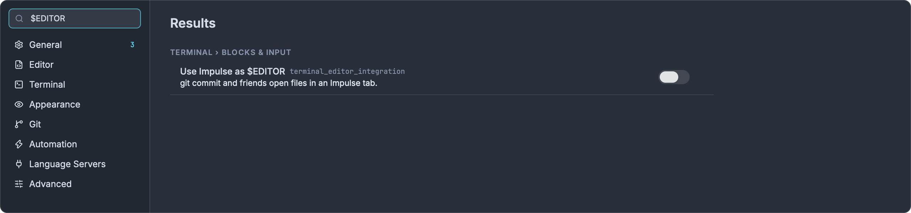
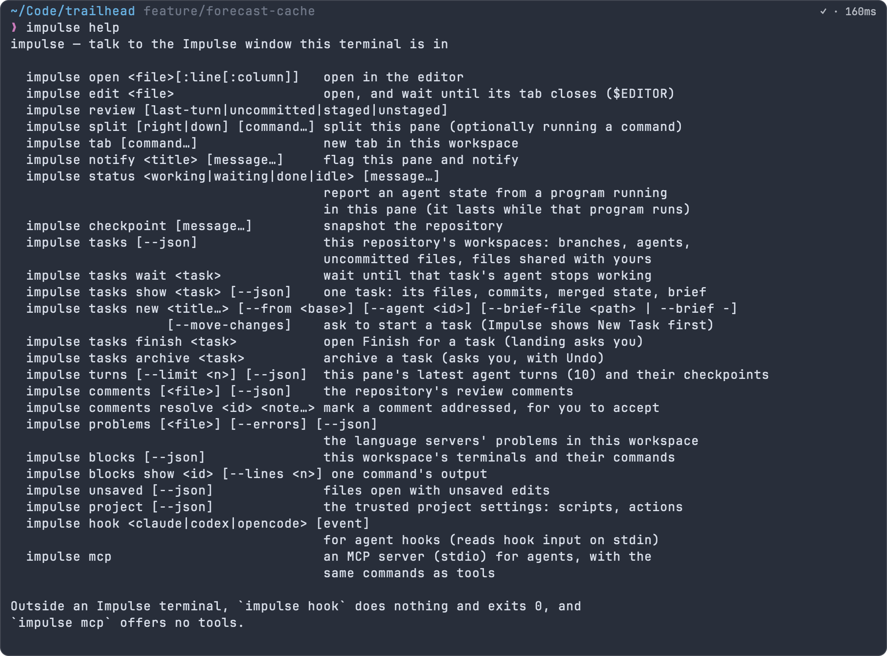

# Command-line tool

`impulse` is a small command-line tool that drives the Impulse window your terminal is in: open files in the editor, wait on an edit (so Impulse can be your `$EDITOR`), open Review, split the pane, notify yourself, and report agent status. It's bundled with the app and is already on `PATH` in every Impulse terminal.

## Where it lives

On macOS the tool is inside the app bundle:

```
/Applications/Impulse.app/Contents/Resources/bin/impulse
```

On Linux it sits beside the app: `/usr/bin/impulse` from the `.deb`, or `bin/impulse` in the folder you unpacked the tarball into.

Every terminal Impulse starts gets that folder at the front of its `PATH`, so `impulse` works without any setup. Impulse terminals also get these environment variables:

| Variable             | Value                                                                                                                                       |
| -------------------- | ------------------------------------------------------------------------------------------------------------------------------------------- |
| `IMPULSE_SOCKET`     | The Unix socket the tool talks to: `~/Library/Application Support/impulse/impulse.sock` on macOS, `$XDG_RUNTIME_DIR/impulse.sock` on Linux. |
| `IMPULSE_PANE_TOKEN` | A token naming this terminal pane, so commands can act on "this pane" (split it, flag it, report its agent's status).                       |
| `IMPULSE_CLI`        | The full path of the `impulse` tool. Agent hooks call it through this variable.                                                             |
| `TERM_PROGRAM`       | `Impulse`                                                                                                                                   |
| `EDITOR`, `VISUAL`   | Set only when [Impulse is your `$EDITOR`](#use-impulse-as-your-editor).                                                                     |

The socket belongs to the running app and serves all its windows. Only your user account can connect to it. A debug build (from `scripts/build.sh --dev`) uses `~/Library/Application Support/impulse-dev/impulse.sock` on macOS and `$XDG_RUNTIME_DIR/impulse-dev.sock` on Linux instead. If another copy of Impulse is already listening there, a second copy leaves that socket alone and gives its own terminals one in a private folder of its own; `IMPULSE_SOCKET` always names the right one.

The [quick terminal](workspaces-and-tabs.md#quick-terminal) gets the same variables. Its requests go to the frontmost window: `impulse tab` opens the tab there, and `impulse split` says "This terminal can't be split." With no window open, `notify`, `status` and agent hooks still work there.

If your shell startup files replace `PATH` outright (rather than adding to it), `impulse` may not be found; use `"$IMPULSE_CLI"` in scripts, or add the folder back to `PATH` in your shell config.

## Commands

| Command                                                     | What it does                                                                                    |
| ----------------------------------------------------------- | ----------------------------------------------------------------------------------------------- |
| `impulse open <file>[:line[:column]]`                       | Open a file in the editor (a folder opens as a workspace).                                      |
| `impulse edit <file>`                                       | Open a file and wait until its tab closes. For `$EDITOR`.                                       |
| `impulse review [last-turn\|uncommitted\|staged\|unstaged]` | Open Review on the current repository.                                                          |
| `impulse split [right\|down] [command…]`                    | Split this pane, optionally running a command in the new pane.                                  |
| `impulse tab [command…]`                                    | Open a new terminal tab, optionally running a command.                                          |
| `impulse notify <title> [message…]`                         | Flag this pane and send a desktop notification.                                                 |
| `impulse status <working\|waiting\|done\|idle> [message…]`  | Report an agent state from a program running in this pane.                                      |
| `impulse checkpoint [message…]`                             | Snapshot the repository's files.                                                                |
| `impulse tasks [--json]`                                    | List the repository's workspaces: branches, agents, uncommitted files, files shared with yours. |
| `impulse tasks show\|wait\|finish\|archive <task>`          | Look at one task, wait for its agent, finish it or archive it.                                  |
| `impulse tasks new <title…> [options]`                      | Ask for a new task, with an agent started on a brief. Impulse asks you first.                   |
| `impulse turns [--limit <n>] [--json]`                      | This pane's latest agent turns (10 unless `--limit`) and their checkpoints.                     |
| `impulse comments [<file>] [--json]`                        | The repository's review comments. `comments resolve <id> <note…>` marks one addressed.          |
| `impulse problems [<file>] [--errors] [--json]`             | The language servers' problems in this workspace.                                               |
| `impulse blocks [--json]`, `impulse blocks show <id>`       | This workspace's terminals and their commands; one command's output.                            |
| `impulse unsaved [--json]`                                  | Files open in the editor with unsaved edits.                                                    |
| `impulse project [--json]`                                  | The trusted project settings: check and setup scripts, actions, `[on_change]` rules.            |
| `impulse hook <claude\|codex\|opencode> [event]`            | Used by agent hooks (and Impulse's opencode plugin).                                            |
| `impulse mcp`                                               | Impulse's MCP server, for agents. See [`impulse mcp`](#impulse-mcp).                            |
| `impulse help`                                              | Print the usage summary. `-h` and `--help` do the same, as does `impulse` alone.                |

Relative paths are resolved against your current directory, and `~` is expanded.

Besides the options a command lists (`--json`, `--errors`, `--lines`, and `tasks new`'s), `impulse` has only `-h` and `--help`, which print the usage summary after any command too (`impulse edit --help`). Any other word starting with `-` where an option could go is a usage error: `impulse edit --wait notes.md` prints `impulse edit: unknown option '--wait'` and exits with status 2, rather than opening a file named `--wait`. For `open` and `edit` that's every argument; for `split`, `tab`, `notify` and `checkpoint` only the first word, so a command you run keeps its own options (`impulse tab ls -la`). Put `--` before a name that starts with a dash: `impulse open -- -notes.md`.

### `impulse open`

```
impulse open <file>[:line[:column]]
```

Opens the file in an editor tab in the Impulse window this terminal belongs to, and brings Impulse to the front. Add `:line` or `:line:column` to jump to a position, the format compilers, linters and `grep -n` print:

```sh
impulse open src/forecast.ts
impulse open src/forecast.ts:42
impulse open src/forecast.ts:42:7
```

With a line and no column, the cursor goes to column 1. If the path is a folder, it opens as a workspace (`impulse open .` opens the current folder). If the file doesn't exist, `impulse` prints `No such file: …` and exits with status 1.

It also opens a pipe, such as bash and zsh's process substitution or fish's `psub`, and anything else in `/dev` (`/dev/fd/5`, `/dev/stdin`):

```sh
impulse open <(git show HEAD~3:src/forecast.ts)
```

`impulse` reads it (up to 10 MB) into a file in the temporary folder, named after it (`63`, say), and opens that. Saving changes that copy.

### `impulse edit`

```
impulse edit <file>
```

Opens the file like `impulse open`, then waits until you close its tab before exiting. That's what an editor launched by `git commit`, `crontab -e` or `kubectl edit` must do, which makes `impulse edit` usable as `$EDITOR`. See [Use Impulse as your `$EDITOR`](#use-impulse-as-your-editor).

- If the file doesn't exist, Impulse creates it empty and opens it. Only the terminal's own shell, or a program started from it, can create a file this way (see [Inside tmux or screen](#inside-tmux-or-screen)).
- Images and folders don't get an editor tab to close, so `impulse edit` returns right away for them.
- A file the editor won't open (a binary file, one larger than 10 MB, one that isn't UTF-8 text or can't be read) makes `impulse edit` exit with status 1 right away, printing `Impulse couldn't open <file> in the editor.`; the window says why. A pipe, or anything else in `/dev`, can't be edited: `impulse edit <(…)` prints `impulse edit: /dev/fd/63 can't be edited in place; impulse open shows a copy`.
- The wait follows the tab, so it still ends when you close the tab after saving it under another name with **Save As**.
- `:line[:column]` works as with `open`.
- Press ⌃C to stop waiting; the tab stays open.
- If Impulse quits while `impulse edit` is waiting, it exits with status 1 ("no answer from Impulse").

### `impulse review`

```
impulse review [last-turn|uncommitted|staged|unstaged]
```

Opens a Review tab for the git repository of your current directory. With no argument, it shows all uncommitted changes.

| Argument      | Review shows                                                                                                                                                  |
| ------------- | ------------------------------------------------------------------------------------------------------------------------------------------------------------- |
| `uncommitted` | Staged and unstaged changes together (the default).                                                                                                           |
| `staged`      | What the next commit will contain.                                                                                                                            |
| `unstaged`    | Changes not yet staged, including untracked files.                                                                                                            |
| `last-turn`   | What the agent in this pane changed in its last turn, or else the latest agent turn in the window's repository. See [Agents](agents.md#review-the-last-turn). |

Outside a git repository, it prints `Not in a git repository.` and exits with status 1. See [Review](review.md).

### `impulse split`

```
impulse split [right|down] [command…]
```

Splits the pane you ran it in: `right` (the default) puts the new pane beside it, `down` below it. The new terminal starts in your current directory. Anything after the direction is run in the new pane:

```sh
impulse split right npm run dev
impulse split down 'npm test -- --watch'
```

The command's words are joined with spaces and typed into the new pane's shell, so quote a command that has its own quoting or shell operators as one argument.

Like `tab` and `checkpoint`, `split` only works from the terminal's own shell, not inside tmux or screen; see [Inside tmux or screen](#inside-tmux-or-screen).

### `impulse tab`

```
impulse tab [command…]
```

Opens a new terminal tab in your current directory, in the workspace you're looking at, and runs the command if you give one:

```sh
impulse tab npm run dev
```

### `impulse notify`

```
impulse notify <title> [message…]
```

Flags this pane as needing attention (its tab and workspace row are marked and the Dock badge counts it) and, when Impulse is in the background, bounces the Dock icon and posts a desktop notification with the title and message. Clicking the notification brings you to the pane. On Linux the notification goes through `notify-send`, the count shows on docks and task managers that read launcher badges, and a click brings you to the pane where `notify-send` supports actions. Useful at the end of anything long:

```sh
npm run build; impulse notify "Build finished" "trailhead"
```

The flag clears when you look at the pane. See [Terminal](terminal.md) for Impulse's built-in notifications when long commands finish.

### `impulse status`

```
impulse status <working|waiting|done|idle> [message…]
```

Reports an agent state for this pane, for agents that Impulse doesn't recognize or that have no hooks, and for your own long-running tools:

| Argument  | State                |
| --------- | -------------------- |
| `working` | **Working**          |
| `waiting` | **Needs your input** |
| `done`    | **Finished**         |
| `idle`    | **Idle**             |

If no agent was recognized in the pane, Impulse starts tracking one called "Agent". `waiting` and `done` flag the pane and notify you like any agent; see [Agents](agents.md#agent-states). Once a pane has reported a status, Impulse stops guessing that agent's state from its output, and the state stays until the next report, however long the program is quiet.

A message may follow the state, for example `impulse status working running migrations`. It's shown after the state in the [agent list](agents.md#the-agent-list) and on the [toolbelt](agents.md#the-toolbelt). Each `impulse status` replaces the message; one without a message clears it.

Call it from the program running in the pane (a wrapper script around your agent, for example). Impulse stops tracking an agent when the pane's current command ends, so running `impulse status` by itself at the prompt has no lasting effect; when you do, it prints a note saying so.

```sh
#!/bin/sh
# my-agent: report status around a tool Impulse doesn't know
impulse status working
long-running-agent "$@"
impulse status done
read -r _   # keep the command running until you've seen the result
```

### `impulse checkpoint`

```
impulse checkpoint [message…]
```

Records a snapshot of the repository you're in: every tracked file, every untracked file that isn't ignored, and what's staged. It doesn't change your files, branch, staged changes or stash. The snapshot is a commit under `refs/impulse/checkpoints/manual/`, and `impulse` prints its ref:

```sh
$ impulse checkpoint before units refactor
refs/impulse/checkpoints/manual/1791382210345-before-units-refactor
```

Without a message, the name ends in `manual-checkpoint`. Use the ref with git, for example to see what changed since, or to bring one file back:

```sh
git diff refs/impulse/checkpoints/manual/1791382210345-before-units-refactor
git restore --source=refs/impulse/checkpoints/manual/1791382210345-before-units-refactor -- src/lib/units.ts
```

Manual checkpoints don't appear in an agent's **Turns** menu. Like agent checkpoints, they're not sent by a normal `git push`, and they're pruned along with them: each time `impulse checkpoint` records one, and the first time in each session that Impulse records an agent turn in the repository, checkpoints older than 14 days, and any beyond the newest 200, are deleted. Outside a git repository, the command prints `Not in a git repository.` and exits with status 1.

### `impulse tasks`

```
impulse tasks [--json]
impulse tasks wait <task>
```

Lists the workspaces of the repository the terminal is in: its main checkout and every [task](tasks.md) Impulse made, open or not. For each: its branch, the base it was made from and how far ahead of and behind it the branch is, its commit, its folder, the agent working there and its state, its uncommitted files, and the files it changes that your workspace changes too. Your own workspace is marked `← you`.

```
trailhead: 2 workspaces

trailhead (main checkout) ← you
  branch main at 3f2a9c1
  /Users/sam/Code/trailhead
  2 uncommitted files

fix-elevation (task)
  branch fix-elevation from origin/main, 3 ahead, 0 behind at 9b1d4e0
  /Users/sam/Code/trailhead.worktrees/fix-elevation
  Claude Code: working
  also changes files you change: src/lib/units.ts
```

It's meant for agents as much as for you: an agent only knows its own folder, and this shows it what the others are doing before it merges a branch or makes sweeping edits. `--json` prints the same as JSON, for scripts.

`impulse tasks wait <task>` waits until no agent is working (or waiting for input) in that task, named by its folder or branch, then exits: a way to let a branch stop moving before merging it. Press ⌃C to stop waiting.

### `impulse tasks show`, `new`, `finish` and `archive`

```
impulse tasks show <task> [--json]
impulse tasks new <title…> [--from <base>] [--agent <id>] [--brief-file <path> | --brief -] [--move-changes]
impulse tasks finish <task>
impulse tasks archive <task>
```

`show` prints one workspace from `impulse tasks` in detail: the files its branch changes against its base, its uncommitted files, its commits ahead of the base (up to 50), whether it's merged into its base (squash merges included), its slot and port values, and the brief it was started with. Name the task by its folder or its branch; the main checkout's name works too.

`new` asks Impulse to start a task, which opens New Task filled in and waits until you create it or cancel; the output is the new task as `show` prints it. `--agent` starts an agent there (`claude`, `codex`, `gemini`, …: an agent Impulse knows, never a command line), on the brief from `--brief-file` or standard input (`--brief -`), at most 16 KB. `--from` is the base; `--move-changes` takes the main checkout's uncommitted files along. See [Tasks agents start](tasks.md#tasks-agents-start) for when Impulse skips the sheet.

`finish` opens the task's Finish tab and runs it up to landing, which waits for you, then prints each step's outcome. `archive` runs Archive Task…, with its questions, and says whether the task was archived. Both wait for their answer; ⌃C stops waiting.

`new`, `finish` and `archive` only work from the pane's own shell or a program it started, like `split`.

### `impulse turns`

```
impulse turns [--limit <n>] [--json]
```

The latest agent turns Impulse recorded in this pane (10 unless you give `--limit`), oldest first, saying how many earlier ones it left out: the agent, when each started, and its start and end checkpoint refs, so `git diff <start> <end>` shows what that turn changed. See [Checkpoints and turns](agents.md#checkpoints-and-turns).

### `impulse comments`

```
impulse comments [<file>] [--json]
impulse comments resolve <id> <note…>
```

Your [review comments](review.md#comments) on the repository, by file and line, each with its id, the lines it was written on, its text, and whether it's outdated (those lines read differently now) or addressed. With a file, only that file's.

`resolve` marks a comment addressed, with a note saying what was done: Review then shows the note under the comment, with **Accept** (which deletes it) and **Reopen**. It's meant for agents working through your review, and only works from the pane's own shell or a program it started.

### `impulse problems`

```
impulse problems [<file>] [--errors] [--json]
```

What the [Problems](editor.md#problems) tab shows for this workspace: each problem's file, line, column, severity, message, source and code, errors first, at most 200, with the counts of everything. `--errors` keeps only errors; a file keeps only that file's. It also lists which files the language servers have checked: a file it doesn't name is unknown, not clean. It never starts a server, so in a folder you haven't trusted it says no servers run there.

### `impulse blocks`

```
impulse blocks [--json]
impulse blocks show <id> [--lines <n>]
```

The terminals in this workspace, each with an id, its title and folder, its agent, and its last 20 [command blocks](terminal.md#command-blocks): the block's id (`3f2a91c0:1042`), its command, folder, exit status, and whether it's still running. `show` prints one block's output, its last 200 lines unless `--lines` says otherwise (at most 2,000).

Settings ▸ Terminal ▸ Agents ▸ **Agents may read terminal output** (`agent_tool_terminal_output`) decides which terminals these see: the workspace's (the default), the window's, or none, in which case `impulse blocks` refuses. The Quick Terminal is never included, and isn't in a workspace, so from it `blocks` sees nothing unless the setting is the window's. Terminal output can hold secrets, so `blocks` only works from the pane's own shell or a program started from it, not inside tmux.

### `impulse unsaved`

```
impulse unsaved [--json]
```

The files in this workspace that are open in the editor with edits you haven't saved, and whether each also changed on disk since. Paths only, never the unsaved text.

### `impulse project`

```
impulse project [--json]
```

How the repository is set up and checked, from its [project settings](project-config.md): the check, setup and archive scripts, the actions, the `[on_change]` rules, the env file's name and, in a task, its slot and ports. Commands are only listed from settings you've trusted; before that, it lists what Impulse found itself (lock files and their install commands, a Compose file).

### `impulse mcp`

```
impulse mcp
```

Impulse's [MCP server](agents.md#impulses-mcp-server): the agent starts it, and talks to it on standard input and output, one JSON-RPC message per line. Its tools are the commands on this page (`list_tasks` is `impulse tasks`, `create_task` is `impulse tasks new`, and so on). Outside an Impulse terminal it answers but offers no tools. You don't run it yourself; install it for your agent with **Install Impulse's MCP Server…**.

### `impulse hook`

```
impulse hook <claude|codex|opencode> [event]
```

What the hooks installed by **Install Agent Hooks…** run; you don't normally call it yourself. Claude Code, and Impulse's opencode plugin, pass their hook input as JSON on standard input; Codex passes its notification JSON as the last argument. Impulse reads the event name (from the argument, or from the JSON), the message and the session id from it:

| Event                                               | Effect on the pane's agent                                                                                    |
| --------------------------------------------------- | ------------------------------------------------------------------------------------------------------------- |
| `SessionStart`                                      | **Idle**                                                                                                      |
| `UserPromptSubmit`                                  | **Working**                                                                                                   |
| `PostToolUse`                                       | **Working**, when it's the tool a permission request was waiting on; else no change                           |
| `Notification`                                      | **Needs your input** if the message asks for permission or input; else **Finished**, if the agent was working |
| `Stop`, `agent-turn-complete`                       | **Finished**; with subagents still running in the background (Claude Code), **Working** until they're done   |
| `StopFailure`                                       | **Finished**, with the API error in the notification                                                          |
| Anything else (`PreToolUse`, subagents, compaction) | No change; subagents' events update the toolbelt's Subagents menu                                             |

For Claude Code, `impulse hook` also prints what Impulse wants the agent to know, which Claude Code passes on: a summary of the repository's other tasks at `SessionStart`, notes after edits and shell commands (`PostToolUse`), a question before a merge (`PreToolUse`), and notes when subagents share a checkout (`PreToolUse` of the Agent tool, and `SubagentStart`). See [What the hooks tell agents](agents.md#what-the-hooks-tell-agents).

Impulse's opencode plugin runs it from the terminal opencode is in, names opencode's own events, and reads Impulse's answer as JSON: `{"context": "…"}` to add to the agent's context, `{"ask": "…"}` to have opencode ask you before the command, with that reason.

| opencode event                                                                    | Effect on the pane's agent                                          | Impulse answers                                                                  |
| --------------------------------------------------------------------------------- | ------------------------------------------------------------------- | -------------------------------------------------------------------------------- |
| `start` (a terminal loaded the plugin)                                            | **Idle**                                                            |                                                                                  |
| `session.start` (a session's first request in this run)                           | No change                                                           | The other tasks' summary, kept beside opencode's instructions for the session    |
| `session.execution.started` (a prompt)                                            | **Working**                                                         |                                                                                  |
| `permission.asked`, `form.created` (a question)                                   | **Needs your input**                                                |                                                                                  |
| `permission.replied`, `form.replied`, `form.cancelled`                            | **Working**                                                         |                                                                                  |
| `tool.execute.before` (shell commands)                                            | No change                                                           | A question before a merge of a branch a task is still on                         |
| `tool.execute.after` (edits and shell commands)                                   | **Working**, when it's the tool a permission request was waiting on | Notes about shared files and changed dependencies, added after the tool's output |
| `session.execution.succeeded`, `session.execution.interrupted` (not a subagent's) | **Finished**                                                        |                                                                                  |
| `session.execution.failed` (not a subagent's)                                     | **Finished**, with the error in the notification                    |                                                                                  |

Outside an Impulse terminal, or when Impulse isn't running, `impulse hook` does nothing and exits with status 0, so the hooks never get in the agent's way. See [Agents](agents.md#agent-hooks).

## Inside tmux or screen

`IMPULSE_PANE_TOKEN` names a pane, but any program that can see a shell's environment could read it. So the commands that start programs, run git or change what's saved where they're asked to, and the one that reads other terminals' output, also check where the request comes from: `split`, `tab`, `checkpoint`, `tasks new`, `tasks finish`, `tasks archive`, `comments resolve`, `blocks`, and `edit` of a file that doesn't exist yet only work from the pane's own shell or a program started from it (an agent's `impulse mcp` is one). The others (`open`, `edit` of an existing file, `review`, `notify`, `status`, `tasks`, `turns`, `comments`, `problems`, `unsaved`, `project` and `hook`) only need the token.

tmux and screen run their shells in a server of their own, not under the shell you started them from, and their panes keep the token of the Impulse pane the server started in. Inside them:

- `split`, `tab` and `checkpoint` print `impulse split only works from the terminal's own shell, not inside tmux or screen.` (with the command's name) and exit with status 1.
- `impulse edit` can't create a file; create it first (`touch notes.md`).
- `review` and `tasks`, and the notes Impulse's hooks give Claude Code, use the folder of that Impulse pane, not the folder you're in inside tmux.
- Agent hooks, `notify` and `status` work as usual.

If the Impulse pane the tmux server started in has closed, commands act as they do [outside Impulse terminals](#use-it-outside-impulse-terminals).

## Exit status

| Status | Meaning                                                                                                                     |
| ------ | --------------------------------------------------------------------------------------------------------------------------- |
| 0      | Success. For `edit`, the tab was closed.                                                                                    |
| 1      | Impulse reported an error, couldn't be reached, or the command isn't running inside an Impulse terminal.                    |
| 2      | A usage error: an unknown command, an unknown option or a missing argument. The usage summary is printed to standard error. |

Messages from Impulse are printed to standard output on success (such as the ref from `checkpoint`) and to standard error on failure.

## Use Impulse as your `$EDITOR`

When `git commit`, `git rebase -i`, `crontab -e` and similar commands need you to edit a file, they open `$EDITOR`. Impulse can be that editor: the file opens in an editor tab, and the command continues when you close the tab.



To turn it on, do one of:

- Turn on **Use Impulse as $EDITOR** (`terminal_editor_integration`) in Settings ▸ Terminal ▸ Blocks & input.
- Run **Use Impulse as $EDITOR in Terminals** from the command palette. It toggles the setting and says "New terminals use Impulse as $EDITOR (git commit opens a tab)." or "New terminals keep your own $EDITOR."

New terminals then start with `EDITOR` and `VISUAL` set to the bundled tool's `edit` command. Terminals that are already open keep their environment, so open a new tab after turning it on. It's off by default.

Then, for example:

1. Run `git commit` in an Impulse terminal.
2. `COMMIT_EDITMSG` opens in an editor tab.
3. Write the message, save (⌘S) and close the tab (⌘W).
4. git finishes the commit. To abort instead, close the tab without writing a message; git sees an empty message and stops.

If your shell startup files set `EDITOR` or `VISUAL` themselves, theirs wins, because they run after Impulse sets the variables. To keep your own editor elsewhere and use Impulse inside Impulse terminals, set it conditionally in your shell config instead of using the setting:

```sh
# ~/.zshrc or ~/.bashrc
if [ -n "$IMPULSE_SOCKET" ]; then
  export EDITOR="impulse edit" VISUAL="impulse edit"
fi
```

```fish
# ~/.config/fish/config.fish
if set -q IMPULSE_SOCKET
    set -gx EDITOR "impulse edit"
    set -gx VISUAL "impulse edit"
end
```

## Use it outside Impulse terminals

In a terminal that Impulse didn't start (Terminal.app or your desktop's terminal, an SSH session, an IDE's terminal), `IMPULSE_SOCKET` isn't set, and `impulse` prints:

```
impulse: not running inside an Impulse terminal (IMPULSE_SOCKET isn't set)
```

You can set the variable yourself to reach a running Impulse on the same computer. On macOS:

```sh
export IMPULSE_SOCKET="$HOME/Library/Application Support/impulse/impulse.sock"
alias impulse=/Applications/Impulse.app/Contents/Resources/bin/impulse
impulse open ~/Code/trailhead/src/server.ts:12
```

On Linux the socket is `$XDG_RUNTIME_DIR/impulse.sock`, and `impulse` is already on your `PATH` if you installed the `.deb`:

```sh
export IMPULSE_SOCKET="$XDG_RUNTIME_DIR/impulse.sock"
impulse open ~/Code/trailhead/src/server.ts:12
```

Without a pane token, requests go to the frontmost Impulse window. `open`, `edit` of an existing file and `review last-turn` work this way. `split`, `tab`, `notify`, `status`, `checkpoint`, `tasks` and the other `review` scopes need a pane, so they refuse with "Run this inside an Impulse terminal.", and `hook` does nothing.

## Examples

```sh
# Open the first failing test's location
impulse open test/metrics.test.ts:9

# Dev server in a pane beside this one, tests watching below
impulse split right npm run dev
impulse split down 'npm test -- --watch'

# Look over what's staged before committing
impulse review staged

# Snapshot before a risky change, notify when a long job ends
impulse checkpoint before units refactor
./scripts/import-trails.sh; impulse notify "Import done" "$(wc -l < trails.csv) trails"
```



## Related

- [Agents](agents.md): hooks, agent states and checkpoints
- [Terminal](terminal.md): shell integration and notifications
- [Review](review.md): what `impulse review` opens
- [Settings and themes](settings-and-themes.md): the `terminal_editor_integration` setting
- [Tasks](tasks.md): task worktrees
