# Full Rust migration: one Impulse for macOS and Linux

Status: exploring, on the `rust` branch. Nothing here ships until the Rust
app passes the parity gate at the end.

## Goal

Replace all of the Swift, UI included, with Rust, so that **one codebase
builds for macOS and Linux and works exactly the same on both**, and looks
one to one with today's Mac app: same layout, chrome, keyboard model,
`settings.json`, files on disk, `impulse` CLI, control socket and agent
integration. The editor is first-class, not a compromise.

"Exactly the same" means Impulse draws its own UI with its own fonts on both
platforms; a toolkit that wraps native widgets would differ between them.

| Terminal | Editor |
|---|---|
| 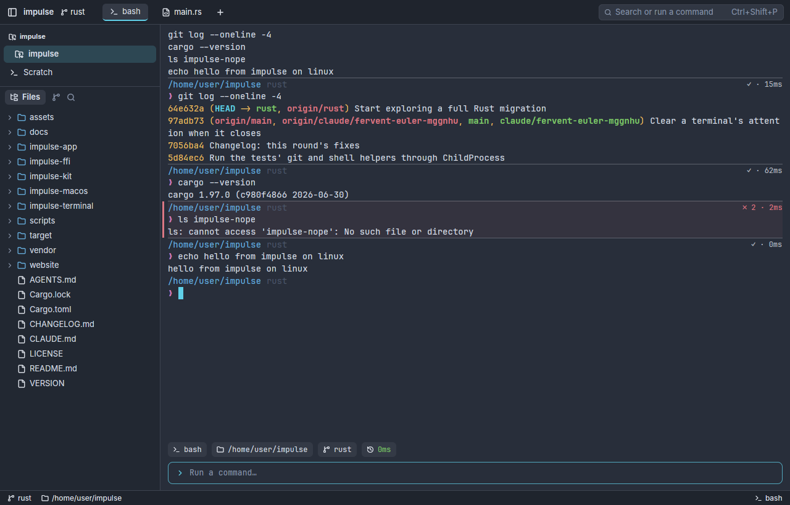 | 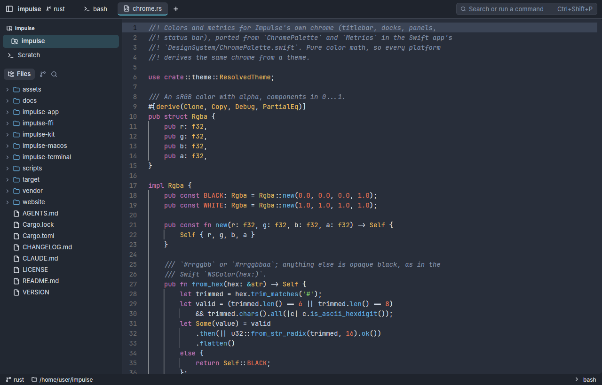 |

*The spike (`impulse-app`) on Linux. Left: bash with Impulse's shell
integration, drawn from the `impulse-terminal` grid, with command blocks (the
failed `ls` gets the red wash, stripe and `✗ 2` chip). Right: GPUI Kit's
`Editor` on one of our files, tree-sitter highlighting in Nord's syntax colors,
line numbers, active line, indent guides, ligatures. Chrome colors from the
ported `ChromePalette`.*

## How other Rust desktop apps build their UI

| App | Toolkit | Editor | Terminal | Accessibility | Platforms |
|---|---|---|---|---|---|
| **Zed** | GPUI (its own) | Zed's `editor` (142k lines; Vim mode, multi-cursor, tree-sitter, LSP) | `alacritty_terminal` + GPUI | none in GPUI | macOS, Linux, Windows |
| **Longbridge Pro** | GPUI + **GPUI Kit** (Apache-2.0) | GPUI Kit `Editor` (tree-sitter, LSP, 200k lines) | none | AccessKit, tested | macOS, Linux, Windows |
| **Lapce** | Floem (its own) | Lapce's editor (Vim mode, LSP) | `alacritty_terminal` | not checked | macOS, Linux, Windows |
| **COSMIC Edit / Term** | iced (libcosmic) | cosmic-text editor | `alacritty_terminal` | not checked | Linux first |
| **SolidCraft**, Rerun | egui + wgpu | none (egui `TextEdit` only) | none | AccessKit (built into egui) | desktop + browser (wasm) |
| Tauri apps (GitButler, …) | system web view | Monaco / CodeMirror | xterm.js | the browser's | macOS, Linux, Windows |

What the survey says:

- **Every Rust app with a serious editor and a terminal draws its own UI on
  the GPU** and uses `alacritty_terminal`, which Impulse already does.
- **SolidCraft** shows the architecture to copy, whatever the toolkit: the UI
  crate is "swappable" and nothing below it depends on the toolkit; feature
  code goes through its own `ui_kit` layer, never raw toolkit frames; the
  desktop app, CLI and MCP server run the same commands (Impulse's CLI and MCP
  tools already work this way); and it renders offscreen for tests. But egui
  has no code editor worth the name, which rules it out for Impulse.
- **The editor decides the toolkit.** The only maintained, reusable native
  Rust code editors are Zed's (inside Zed: it depends on `project`,
  `workspace`, `client`, `rpc`, `settings` and `telemetry`, so using it means
  forking Zed), Lapce's (inside Lapce, on Floem), and **GPUI Kit's**, which is
  built to be embedded and is published on crates.io.
- **Keeping Monaco** means a web view, which on Linux embeds in a GPU-drawn
  window only under X11 or XWayland (GPUI Kit's own `gpui-webview` says so:
  "GTK cannot embed into a Wayland surface it does not own"), and a native
  child window sits above everything Impulse draws, so the palette, menus and
  popovers could not overlap the editor. The only way to keep Monaco on both
  platforms the same is to make the whole UI a web page (Tauri), which gives
  up the native terminal renderer and runs on WebKitGTK on Linux.

## Toolkit: GPUI with GPUI Kit

GPUI is Zed's toolkit: everything drawn on the GPU (Metal on macOS, Vulkan
on Linux with X11 and Wayland), text by CoreText on the Mac and cosmic-text on
Linux. GPUI Kit (Longbridge, Apache-2.0, committed to the day before this was written) is a component library
on top, and covers what GPUI alone was missing for Impulse:

- **Editor**: multi-cursor and column selection, folding, search, tree-sitter
  highlighting for ~35 languages, LSP completion, hover, diagnostics,
  go-to-definition and code actions, decorations. Shown working above, with
  real input (multi-cursor typing and the search panel,
  [screenshot](images/rust-spike-editor-input.png)).
- **Accessibility**: AccessKit roles, names, states and actions in the
  interaction layer, with tests (VoiceOver on the Mac, Orca on Linux).
- **Headless UI tests**: render components in headless windows, drive pointer
  and keys, assert state, focus, layout and accessibility.
- Dock layout with resizable panels and draggable tabs, virtual lists and
  tables, a diff component, native Markdown, menus, dialogs, notifications.
- One dependency, `gpui-kit`, pinned exactly (`=0.8.0`); it re-exports the GPUI
  snapshot it was built against (`gpui-pre`, from crates.io), so no git
  dependencies or patched lockfiles.

Impulse keeps its own look: GPUI Kit's components take a theme, and ours
comes from `ChromePalette` (the editor's syntax colors already come from
Impulse's theme, mapped the way `themeToMonaco` maps them). Its own chrome
(the search panel in the screenshot above) still shows GPUI Kit's default
theme; theming it is the next step.

Following SolidCraft, all Impulse views go through our own component layer
(`impulse-ui`) over GPUI Kit, so a GPUI or GPUI Kit change is fixed in one
place, and nothing below the app depends on the toolkit.

## The editor: what Monaco does today, and the gap

From `impulse-macos/web/editor.js` and `docs/editor.md`, Impulse uses Monaco
for:

| Monaco feature Impulse uses | GPUI Kit `Editor` | Work |
|---|---|---|
| Highlighting, folding, line numbers, indent guides, whitespace, word wrap, ligatures | yes | **done**: colors from Impulse's theme |
| Multi-cursor, column selection, ⌘D next occurrence | yes, ⌘D ours | **done**: Monaco's keys on both platforms (`editor_keys.rs`): ⌘D as whole words, toggle comment, move, copy and delete lines, insert line above or below, F12, ⌘I and Ctrl+Space for suggestions |
| Find and replace widget | yes (replace is a toggle in its panel) | **themed**; first keystroke into it is lost under Xvfb (below) |
| LSP: completion, hover, diagnostics, definition | yes | **done**: wired to `impulse-lsp`, checked against rust-analyzer; definition into another file not yet exercised |
| LSP: code actions, Format Document (⌥⇧F) | yes | **done**: every server's actions (⌘. or Ctrl+.), resolved when picked; formatting as one undo step |
| Rename (F2), Find References (⇧F12), edits across files | no | **done**: rename through `prepareRename`; workspace edits applied across open tabs and files on disk, asking first as `LSPWorkspaceEdits` does; references in a list that opens each place (a peek view comes with the peek work) |
| LSP: document highlight, type definition, implementation, declaration | no | **done**: occurrences as range decorations (with Monaco's word fallback), the three Go to commands (⌘F12/Ctrl+F12 for implementations) |
| LSP: signature help, inlay hints | no | signature help **done** (on `(` and `,`, following the active parameter, Escape or `)` to close, `impulse_lsp::signature`); inlay hints need text injected into the editor's line layout, which GPUI Kit's editor doesn't have (only one ghost-text completion at the caret), so they wait on a change upstream or in a fork |
| Peek views (definition, references, git peek), view zones | no | build on its decorations and overlay hooks |
| Diff editor (side by side and inline) | diff component exists | **done** side by side (Toggle Diff View: HEAD read-only beside the live buffer, changed lines tinted); not yet padded to line up, no inline mode |
| Vim mode (monaco-vim) | no | **done**: `impulse_kit::vim`, a state machine on plain text (Normal, Insert, Visual, Visual Line and Replace; counts, motions, `d c y > < gu gU g~` with motions and text objects, registers with `+`/`*` as the clipboard, `.`, `/ ? n N * #`, `:w :q :wq :x :{line} :s :d :y :noh`), over the editor in `editor_vim.rs`; the mode in the status bar, an inverted character as the block cursor; not yet macros, marks, Visual Block or incremental search |
| Sticky scroll, minimap, bracket pair colors | no | bracket pair colors **done** (`impulse_kit::bracket_pairs`: Monaco's three colors by depth, unmatched in red, strings and comments skipped by a small lexer per language family); sticky scroll next; minimap last |
| Context menu with Impulse's items | menus yes | **done**: Monaco's items (navigation, rename, Change All Occurrences, format, code actions, clipboard, Command Palette) |
| Git in the editor: change marks, peek, inline blame, conflicts | view zones, decorations | **done**: marks against the index painted over the gutter (GPUI Kit has no gutter decorations), the peek docked under the editor (Revert, Stage, Diff, Review), inline blame after the resting cursor's line, Show Commit for This Line, conflicts tinted with a bar for Accept Current, Incoming or Both and ↑↓ (Monaco puts these in view zones per block) |
| Save pipeline and files changed on disk | n/a (ours) | **done**: a "changed on disk" question (Save Anyway, Reload from Disk), formatter and commands on save in trusted folders, their results adopted as one edit; open files' folders watched, clean editors reloading what agents and git write |

This is real work, but it is work on an editor built for embedding, and the
rest of Impulse's editor behavior (save, format on save, reload in place,
size limits, dirty marks, conflict actions, preview tabs) is Impulse's own
code either way. If GPUI Kit's editor stops fitting, the fallback is the same
toolkit with Zed's editor through a fork, not a different toolkit.

## What else changes so the two platforms match

- **Fonts**: the chrome uses SF Pro today, which can't ship on Linux. Both
  platforms use the bundled Inter (chrome) and JetBrains Mono (terminal,
  editor), already in `vendor/fonts`. A small, deliberate change on the Mac.
- **Window chrome**: the titlebar band is Impulse's own on both. macOS keeps
  its traffic lights in the 78pt inset; Linux draws its own window buttons.
- **Keyboard**: one keymap where `secondary` is ⌘ on macOS and Ctrl on Linux.
  In a terminal Ctrl belongs to the shell, so on Linux terminal focus uses
  Ctrl+Shift for Impulse's shortcuts, as Linux terminals do. Find is
  Ctrl+Shift+F and New Tab Ctrl+Shift+T in a terminal (Project Search and
  Reopen Closed Tab everywhere else), the way other Linux terminals use them
  (`keybindings::TERMINAL_FIRST`).
- **Quick Terminal**: a borderless pop-up window at the top of the screen
  with its system-wide shortcut from `global-hotkey` (Carbon on macOS, as
  today; XGrabKey on X11). Wayland lets no app take a system-wide key, so
  there it's Toggle Quick Terminal in the palette, or a desktop shortcut.
- **Menus**: the macOS menu bar; on Linux the same menus from a titlebar
  button (both from `impulse_kit::menus`, done). The palette has every
  command on both. On Linux, Quit is Ctrl+Shift+Q and Tab 1 to 9 Alt+1 to 9,
  keys a shell doesn't read.
- **Markdown preview**: native, from cmark-gfm's AST or GPUI Kit's Markdown
  (raw HTML is already elided).
- **Review and History syntax colors**: the editor's tree-sitter grammars
  instead of highlight.js, so the editor and Review color code alike.
- **Platform services** behind one `impulse-platform` crate:

| Need | macOS | Linux |
|---|---|---|
| Foreground process, agent detection, port scan | libproc | `/proc` |
| Control-socket caller pid | `LOCAL_PEERPID` | `SO_PEERCRED` |
| File watching | FSEvents (`notify`) | inotify (`notify`) |
| Notifications | UserNotifications | freedesktop notifications |
| Open/save panels | GPUI (NSOpenPanel) | GPUI (xdg portal) |
| Reveal in file manager | `open -R` | `org.freedesktop.FileManager1` |
| Settings, themes, sessions | `~/Library/Application Support/impulse` (as today) | `$XDG_CONFIG_HOME/impulse`, `$XDG_DATA_HOME/impulse` |
| Packaging | `.app` + `.dmg`, signed and notarized | AppImage and `.deb` |

## Dependency map

| Swift today | Rust |
|---|---|
| AppKit + SwiftUI | GPUI + GPUI Kit |
| CoreText terminal renderer | GPUI text (spike: `impulse-app/src/terminal_view.rs`) |
| WKWebView + Monaco + monaco-vim | GPUI Kit `Editor` + our additions |
| JavaScriptCore + highlight.js | tree-sitter |
| Clibgit2 (vendored, no transports) | `git2` with `vendored-libgit2`, no default features |
| `git` CLI writes | `std::process::Command`, same arguments and environment |
| TOMLKit | `toml` (+ `toml_edit` for `ProjectSettingsFile`) |
| swift-cmark gfm | cmark-gfm via `cc` |
| SQLite | `rusqlite` (bundled), same schema and file |
| Swift Testing | `cargo test` + GPUI Kit's headless UI tests |

## Layout

```
impulse-terminal/   terminal emulation (unchanged; macOS + Linux)
impulse-kit/        pure logic: themes, chrome palette, parsers, …   [ported]
impulse-git/        git2 reads + git CLI writes                       [ported]
impulse-lsp/        language-server client                            [ported]
impulse-protocol/   control socket + MCP server                       [ported]
impulse-cli/        the `impulse` binary                              [ported]
impulse-platform/   the per-OS services above
impulse-ui/         Impulse's components over GPUI Kit
impulse-app/        the app                                     [in progress]
```

Nothing below `impulse-ui` depends on GPUI. `impulse-ffi`, the Swift package
and `impulse-macos/web/` are deleted at cut-over.

## Phases

The shipped Swift app keeps working through every phase.

1. **Editor first** (in progress). Because the editor matters most and is the
   biggest unknown, it goes first. Done: GPUI Kit's chrome themed from
   Impulse's theme, editor tabs opened from the file tree with Impulse's file
   rules, save, dirty marks, the editor status bar, workspace trust (the same
   prompt and `trusted-folders.json` as the Swift app), the `lsp.json`
   config, `impulse-lsp` wired to the editor (diagnostics, hover, completion,
   definition, code actions, Format Document, rename, references), edits
   across files with the Swift app's confirmation rules, and Monaco's keymap.
   Since: occurrence highlights, Go to Type Definition, Implementations and
   Declaration, Monaco's context menu, the Diff View, signature help and
   Vim mode. Since then too: Undo for a whole edit across files (a toast,
   as in Swift), `workspace/applyEdit` from servers, and the Swift
   client's capabilities (resource operations, so rust-analyzer renames a
   module's file). Next: peek views. Exit:
   daily-drivable on a real project, on both platforms.
2. **Logic crates, with parity** (done). Port ImpulseKit, ImpulseGit, ImpulseLSP and
   ImpulseProtocol: revive the `v0.29.0` Rust where it exists, pass the golden
   fixtures read in place from `impulse-macos/Tests/*/Fixtures/`, port each
   module's Swift unit tests. All in Linux CI.
3. **The CLI** (ported; replacing the Swift one in the bundle is next). The Rust `impulse` and `impulse mcp` replace the Swift ones in
   today's bundle, proven by the smoke scenarios that use them.
4. **App shell and terminal** (in progress: window, workspaces, tabs, split
   panes, commands and keybindings, settings.json, session restore, the
   control server, the terminal's grid, keys, selection and mouse, and the
   headless snapshot mode are in).
   Window, tabs, panes, workspaces, docks, status
   bar, control server, settings, keybindings, session restore (same files),
   the full terminal (selection, search, links, sticky headers, block toolbar,
   input bar with completion, Kitty keyboard), and the headless snapshot mode
   with its `dump=` format.
5. **Surfaces.** File tree, palette, search, Review and History, git panels,
   tasks, agents, settings, project setup, notifications.
6. **Parity gate and cut-over.** `scripts/smoke/run.py` against the Swift app
   and the Rust app on both platforms (dumps must match);
   `scripts/docs/capture.py` from the Rust app on both platforms (Mac against
   Linux within a small pixel threshold); manual IME, VoiceOver and Orca,
   HiDPI and fractional scaling, gestures. Then `build.sh` builds the Rust
   app, Linux packages join `scripts/release.sh`, the Swift targets go.

## Done so far

| Editor tabs | Diagnostics | Completion |
|---|---|---|
| 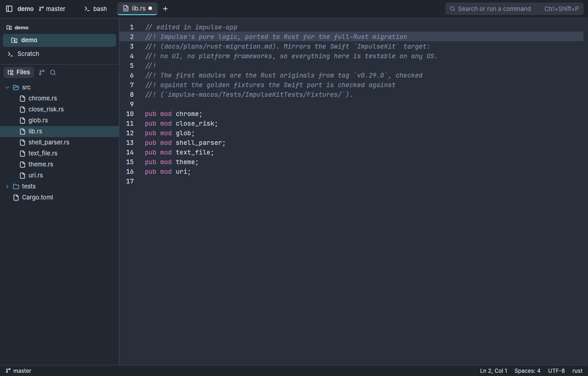 | 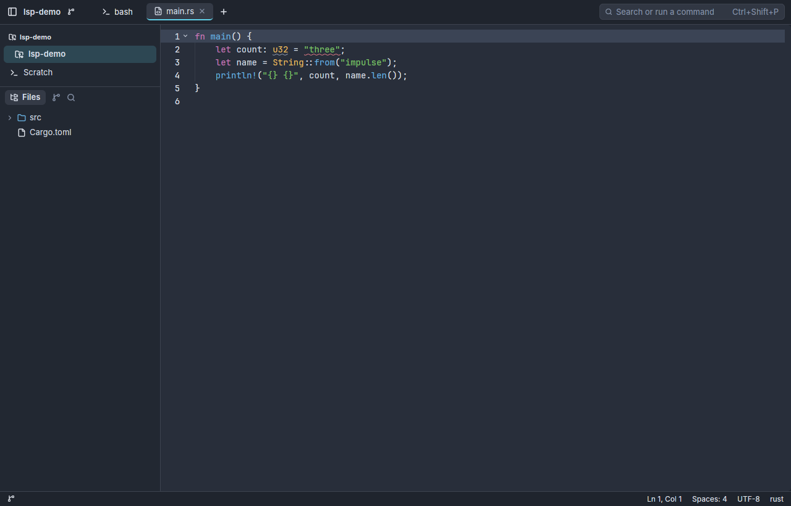 | 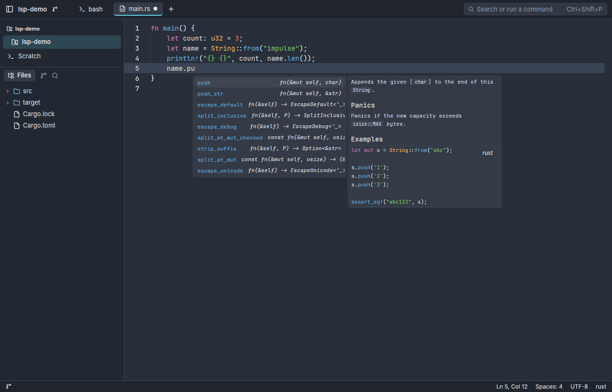 |

*Linux, under Xvfb. Left: a folder expanded in the file tree, `lib.rs` open
with an unsaved edit (the dot), the editor status bar. Middle: rust-analyzer's
type error, live while typing. Right: `name.pu` narrowed to `push` and
`push_str`, with the method's documentation.*

| Trust prompt | Code action |
|---|---|
| 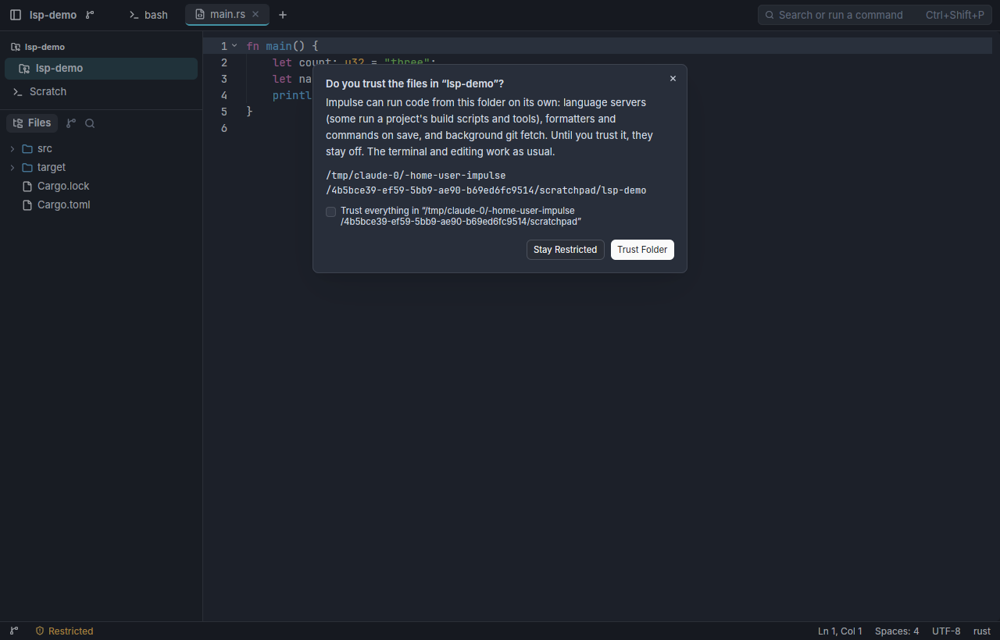 | 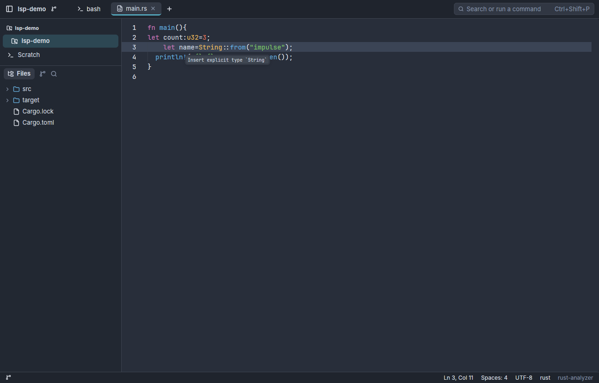 |

| Rename across files | Find References |
|---|---|
| 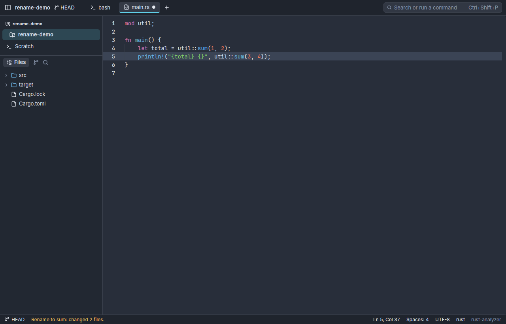 | 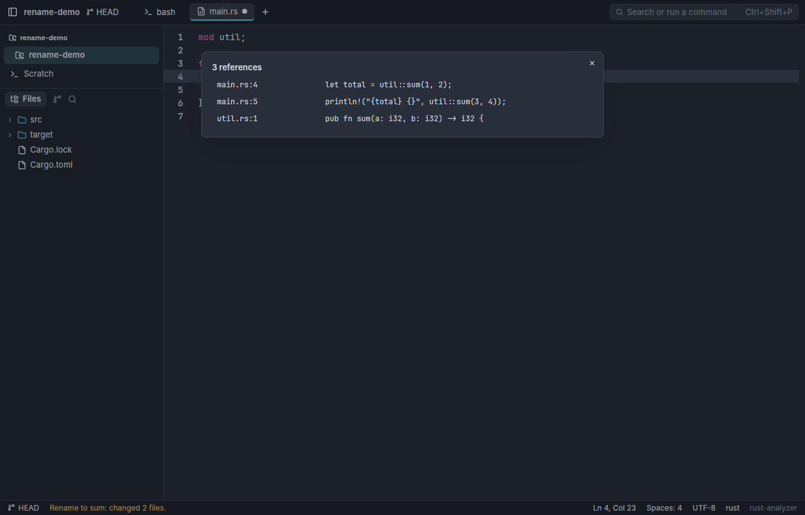 |

*Renaming `add` to `sum` in `main.rs` changed both of its calls in the open
tab and the definition in `util.rs`, which wasn't open, on disk; the status
bar reports it. Find References lists each place with its line; picking one
opens it at the symbol.*

*Left: opening a folder that isn't trusted asks, as the Swift app does; the
status bar says Restricted until it's trusted, and language servers start for
the open files the moment it is. Right: rust-analyzer's assist on ⌘. / Ctrl+.,
which inserts the type when picked.*

- `impulse-terminal` builds and passes all 112 tests on Linux.
- `impulse-kit`: `line_edits` (Monaco's line commands and ⌘D as plain text
  operations, with tests); `trust` (the Swift `WorkspaceTrust` and all its tests, reading
  and writing the same `trusted-folders.json`) and `paths` (the data
  directory: `~/Library/Application Support/impulse` on macOS as today,
  `~/.local/share/impulse` on Linux; `impulse-dev` for debug builds). `glob`, `close_risk`, `shell_parser`, `theme` and `uri`
  (file URIs and language ids) revived from `v0.29.0`; `chrome`
  (`ChromePalette`, `Metrics`) and `text_file` (the Swift `TextFile` and the
  open checks in `TabManager`: UTF-8 only, BOM kept, writes through symlinks
  keeping permissions, binary and size limits) ported. They pass the `glob`,
  `close_risk`, `shell_parser`, `path_to_uri`, `uri_to_path`,
  `language_from_uri` and all 19 `themes/*.theme.json` fixtures, plus the
  Rust twins of the Swift unit tests.
- `impulse-lsp`: the language-server client with no UI and no executor of its
  own. `Content-Length` framing, the server process and its reader thread,
  the initialize handshake (asking for UTF-32 positions, which are GPUI Kit's
  character columns, and converting when a server only does UTF-16), answers
  to the server's own requests (`workspace/configuration` with the Swift
  app's settings), document sync, `config` (the Swift `LSPConfig`: the 18
  default servers and their languages, root markers, the global and project
  `lsp.json` with the same trust rules, root detection that never goes above
  the trusted folder, initialization options), `edits` (the Swift
  `TextEditApplier`: edits against the original text, inserts keeping their
  order, `\r\n` lines, overlaps refused; and the one span that changed),
  `workspace_edit` (the Swift `WorkspaceEdit`: operations in order, the
  confirmations, the edit boundary, with its tests),
  and completion filtering as Monaco does it. An end-to-end test runs
  rust-analyzer (diagnostics, hover, completion) and skips where it isn't
  installed.
- `impulse-app` on GPUI Kit: a live terminal; editor tabs opened from the
  file tree or `--open`, with dirty marks, close buttons, Save (`secondary-s`,
  ⌘S or Ctrl+S) and Close Tab (`secondary-w`); a save that would overwrite a
  change made on disk, or a close that would lose edits, asks by needing a
  second press; the editor status bar (`Ln 5, Col 12`, `Spaces: 4`, `UTF-8`,
  language, running servers); every GPUI Kit component themed from Impulse's
  theme; the trust prompt and Restricted indicator; and, in trusted folders,
  every configured and installed server for the file in its project root,
  with merged diagnostics, hover, completion, go-to-definition, code actions
  and Format Document (⌥⇧F). `--trust` trusts the folder without asking, for
  scripted runs.
- The rest of the logic is ported, each crate with the Swift tests and
  golden fixtures of its Swift twin: `impulse-kit` (454 tests: settings and
  the settings catalog, keybindings, key encoding, layout trees, palette and
  fuzzy matching, file tree patches, previews, Monaco and Markdown theme
  colors, shell types, quoting, login shell and integration, completion,
  command history, kitty keyboard, terminal hints and paths, project
  config, task registry and environment, agents' state machine, hooks and
  installers, session state), `impulse-git` (169 tests against the Swift
  git fixtures, libgit2 1.9.7 vendored without network transports),
  `impulse-protocol` and `impulse-cli` (64 tests; control lines byte for
  byte as the Swift app writes them).
- The app shell: folder workspaces and Scratch, each with its tabs; tabs of
  split panes laid out by `LayoutTree` with draggable dividers, zoom, and the
  pane commands; preview tabs (a single click in the file tree, replaced by
  the next until edited, split or double-clicked), pinned tabs (icon only,
  saved with the session, closing asks), tabs dragged to reorder, and the
  tab context menu (pin, close, move into the current tab, even out panes); every command as one `RunCommand` action bound from the
  keybinding table (Mac defaults as today, Linux ones as the v0.29 Linux app
  had them, with plain Ctrl+letter left to the shell in terminals);
  settings.json watched and merged as `SettingsStore` does; session restore
  from the same `session-state.json` and scrollback files; the control
  socket for `impulse` (`open`, `edit` waiting for the tab, `split`, `tab`,
  `notify`, `status`, `hook`, `turns`, `blocks`, `review`, `checkpoint`,
  `unsaved`, `comments` with `resolve`, `problems`, `tasks`, `project`).
- Tasks: New Task (the sheet, the worktree beside the repository, copies,
  the task list and its slot, the task's own values and setup script once
  the project settings are trusted, the main checkout's changes moved in
  with Undo), New Task from Branch (`task:`), Finish Task (its tab: commit
  check, sync, the check script in a terminal, landing through
  `impulse_git::landing`, update, clean up), Archive Task and Archive Merged
  Tasks with Undo, and the sidebar's repository groups with the merged and
  overlap chips. A task's terminals get `IMPULSE_TASK`, `IMPULSE_TASK_SLOT`
  and `IMPULSE_REPO_ROOT`. Agents ask for tasks too (`impulse tasks
  new|finish|archive` and the MCP tools on them): New Task opens prefilled
  with who asked and the brief (or, with `agent_task_creation =
  trusted_projects`, the task is made without the sheet, with Undo), the
  brief kept in `.git/impulse/tasks/<task>/brief.md` and given to the agent
  as its first prompt; Finish runs up to landing and waits for the user,
  and its commit step stops while another agent works in the task;
  `impulse tasks show|wait` and `impulse project` answer as the Swift app
  does.
- Problems and review comments, as the Swift app has them: every language
  server's diagnostics kept per file (open or not) for the Problems tab
  (`show_problems`, Ctrl+Alt+M on Linux: by file, files with errors first,
  severity toggles, a filter, click to open at the problem, Copy as
  Prompt) and the status bar's error and warning counts; Review's comments
  written from a line's +, a hunk's Comment or c, shown under the last line
  they cover, floating to the top once their lines read differently,
  edited and deleted in place, and an agent's resolution (`impulse comments
  resolve`) shown with Accept and Reopen; saved in the same
  `review/<digest>.json` as the Swift app and read again when it changes.
  Problems' Fix with Agent and Review's comments menu send to an agent's
  terminal as well.

| Problems | Review comments |
|---|---|
| 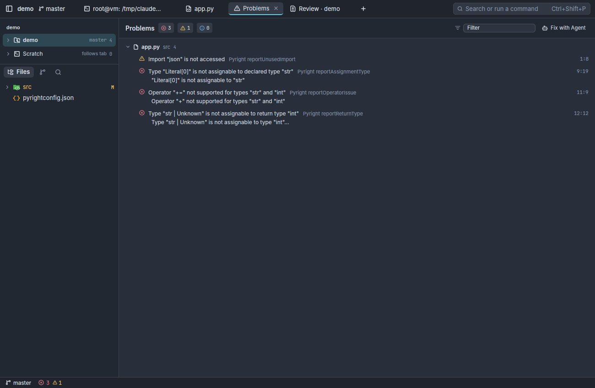 | 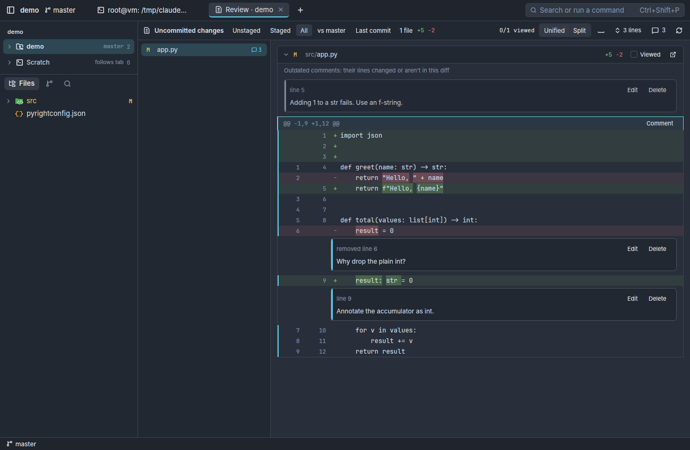 |

*Right: a comment whose line changed since it was written floats to the
top of the file's card; one on a removed line and one written with c on
the focused hunk sit under their lines.*

- The editor's Diff View (Toggle Diff View): the file at HEAD, read-only,
  beside the editable buffer, removed lines tinted on the left and added
  ones on the right as you type (`impulse_git::buffer_diff`). Unlike
  Monaco's diff editor the two sides aren't padded to line up yet. Also
  Monaco's context menu, Go to Type Definition, Implementations and
  Declaration, Change All Occurrences, and occurrence and selection
  highlights.
- Agents: Claude Code, Codex, opencode and the other known agents are found
  in a terminal from its foreground process (`/proc` on Linux, libproc and
  `KERN_PROCARGS2` on macOS) and from their hooks (`impulse hook`), and
  `AgentStateMachine` follows each one: its glyph on titlebar tabs and
  sidebar rows, attention dots, the agents inbox in the titlebar (most
  urgent first, Review on a turn), Next Agent Needing You, and a desktop
  notification when one needs input or finishes while the window isn't
  active (`notify-send`, and `osascript` on the Mac in place of
  UserNotifications for now). Each turn is checkpointed under
  `refs/impulse/checkpoints/` for Review Last Agent Turn, `impulse review
  last-turn` and `impulse turns`; `impulse blocks` reads the workspace's
  command blocks; the hooks get Impulse's replies (the repository's tasks
  when a session starts, shared-file and dependency notes, the question
  before merging a task's branch still in progress). The Agent Integration
  dialog installs and removes the hooks and the MCP server with
  `impulse_kit::agents`' installers. Under the agent's terminal, the
  toolbelt (its state and time, Compose, Review Turn, and Turns, to review
  one or restore the files to before it), and the composer over its TUI
  (several lines, @ mentions of the workspace's files, ↑ for earlier
  messages; Ctrl+Return sends on Linux, ⌘↩ on the Mac). Text for an agent
  (Send Selection to Agent, a command block's Send to Agent, Problems,
  review comments, conflicts) is typed into its prompt as a paste, and
  waits while it's mid-turn. Turns are kept in the session file, and a
  desktop notification's click shows its terminal where `notify-send`
  takes `--action` (libnotify 0.7.10 and later; it waits in a thread of
  its own until the notification closes).

| Agents inbox | Agent Integration |
|---|---|
| 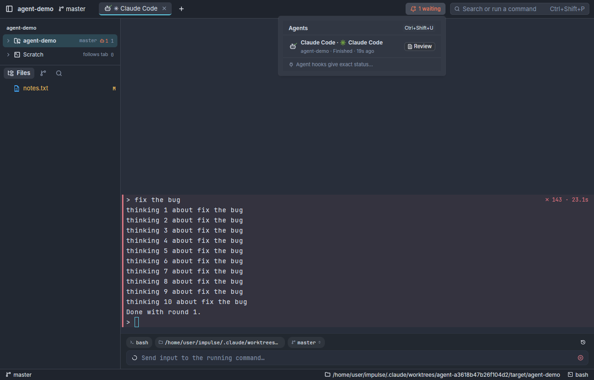 | 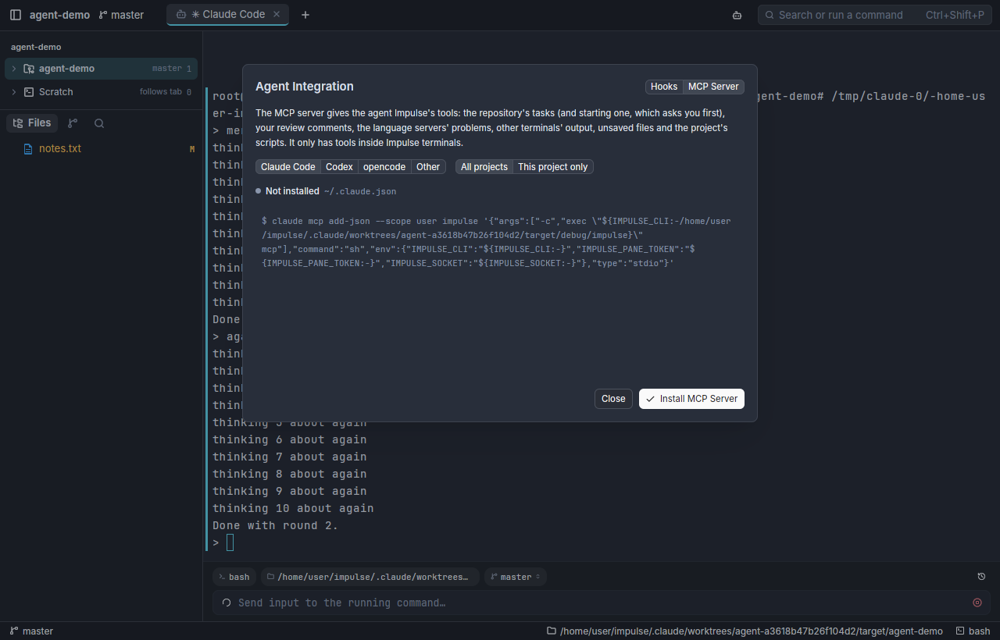 |

*Left: a stand-in Claude Code with Impulse's hooks finished a turn: the bot
with a check on its tab and in the sidebar, "1 waiting" in the titlebar, and
the inbox with Review for the turn's checkpoints. Right: Agent Integration
on the MCP server for Claude Code, the `claude mcp add-json` command it
runs.*

| Agent composer | An agent's New Task |
|---|---|
| 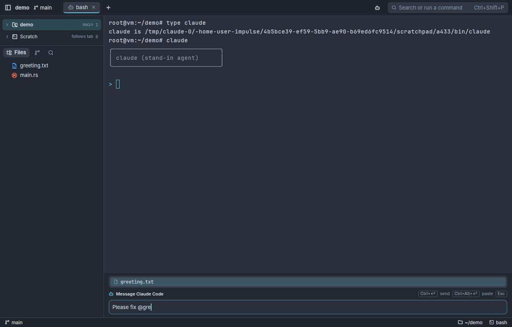 | 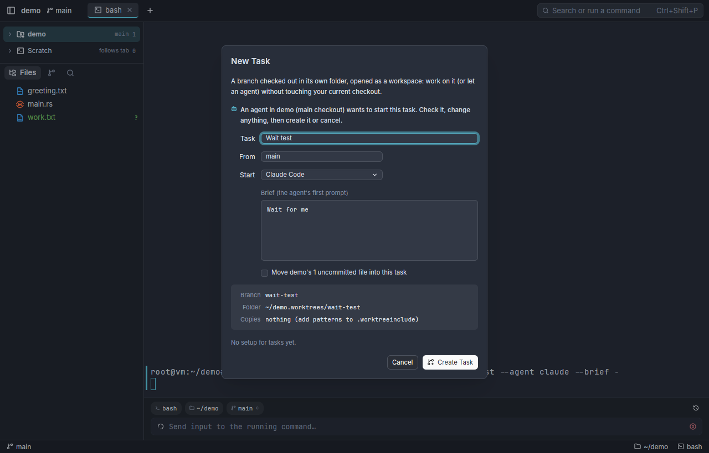 |

*Left: the composer over a stand-in Claude Code, an @ mention listing the
workspace's files. Right: New Task as an agent asked for it (`impulse tasks
new --agent claude --brief -`), prefilled with who asked and the brief.*

- Project settings: the Project Setup tab
  ([screenshot](images/rust-project-setup.png)), proposing copies,
  clones, the database, ports, values, scripts, rules and actions from the
  repository and saving the managed sections of `.impulse/project.toml`
  (trusting what it wrote, folding in and removing a local
  `.git/impulse/project.toml` Impulse wrote, asking when the file changed
  meanwhile), Try in a New Task and Re-apply; reached from the palette,
  the sidebar's menu, New Task's "Set Up This Project for Tasks…" and
  Finish's "Set Up a Check…". Project actions in the palette's `a:` mode,
  in a tab or a split, once trusted. After a pull, merge or checkout, a
  toast offers the `[on_change]` commands (or the setup script) and, after
  a merge, the check script.
- The terminal draws its own grid (cell runs, selection and search ranges,
  the cursor, block washes, stripes, separators and status chips), takes
  keys through the port of `KeyEncoder` and text through GPUI's input
  handler (so input methods work), selects by word, line or block, reports
  the mouse to programs that ask, and starts the login shell with Impulse's
  integration as `TerminalTab` does.
- `scripts/spike/linux-shot.sh` screenshots the app under Xvfb with software
  Vulkan, so CI can check the UI without a GPU.
- The headless snapshot mode (`debug_snapshot.rs`, debug builds only, as
  the Swift `DebugSnapshot`): the same `--impulse-snapshot*` flags, the
  actions run one after another, `until=` conditions and the `dump=` JSON
  the smoke checks read; window images by ImageMagick's `import` on X11
  (Xvfb included) and `screencapture -l` on macOS (not yet tried on a
  Mac). `scripts/smoke/run.py` and `scripts/docs/capture.py` run the Rust
  app when `IMPULSE_SNAPSHOT_APP` names its binary (the default on Linux),
  in the same demo home (its data folder `~/.local/share/impulse-dev` on
  Linux), composing shots with `scripts/docs/imagetool.py` where there's
  no Swift. The Rust app has no Monaco to script, so its editor and lsp
  scenarios use `edit=` (cursor, select, type, paste, undo, redo) and
  `lsp=` (hover, completion, definition, rename through the app's own
  paths) where the Swift ones run `js=`. On Linux under Xvfb every
  scenario passes. Shots cropped to a floating window
  (`crop: "overlay"`) need the in-window dialog's bounds in
  `snapshot.log`.

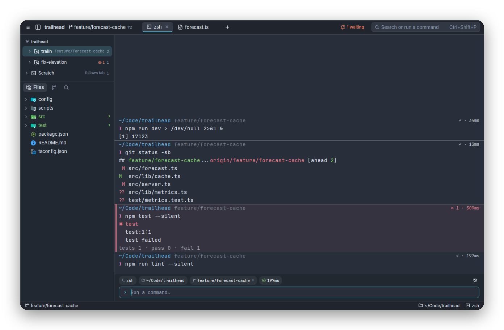

*`capture.py getting-started-window-tour` from the Rust app on Linux.*

Known issues:

- Under Xvfb, the first key typed into the editor's search field is lost
  (focus moves there at once in GPUI Kit's code, so this looks like key
  input on X11 without a window manager). To check on a real Linux desktop
  and on the Mac.
- GPUI Kit's hover popover draws a code block's language label on top of
  the code ([screenshot](images/rust-editor-hover.png)).
- Completions insert plain text: snippet support is off until GPUI Kit's
  snippet handling is checked.
- Settings the Rust app doesn't act on yet: `minimap_enabled`,
  `sticky_scroll`, `editor_inlay_hints`
  (GPUI Kit's editor has none of these), `editor_cursor_style` and
  `editor_cursor_blinking` (its caret has no styles), `smooth_scrolling`,
  `terminal_bell` (no
  sound through GPUI; the attention dot still shows) and
  `terminal_scroll_on_output` (the terminal always follows output unless
  scrolled back).
- Word-based suggestions take words from the document being edited only,
  for every setting but `off` (Monaco's `matchingDocuments` and
  `allDocuments` look in other open files too).
- The app hasn't been built on a Mac yet.

## Risks

- **The editor gap** (table above): peek views and the diff editor are
  ours to build.
- **Two young dependencies**: GPUI is pre-1.0 and GPUI Kit pins its own GPUI
  snapshots. Exact pins plus `impulse-ui` contain the churn; the fallback for
  either is the code itself (both are open source).
- **SwiftUI to GPUI by hand**: GPUI's layout is flexbox, close to how the
  SwiftUI views stack, but spacing, truncation, hover and focus states are
  matched one view at a time; the pixel diff is the safety net.
- **This reverses the 2026 rewrite**, which left Rust and Linux for the Mac.
  The difference now: one toolkit draws both platforms, so there is no second
  frontend to keep in step.
